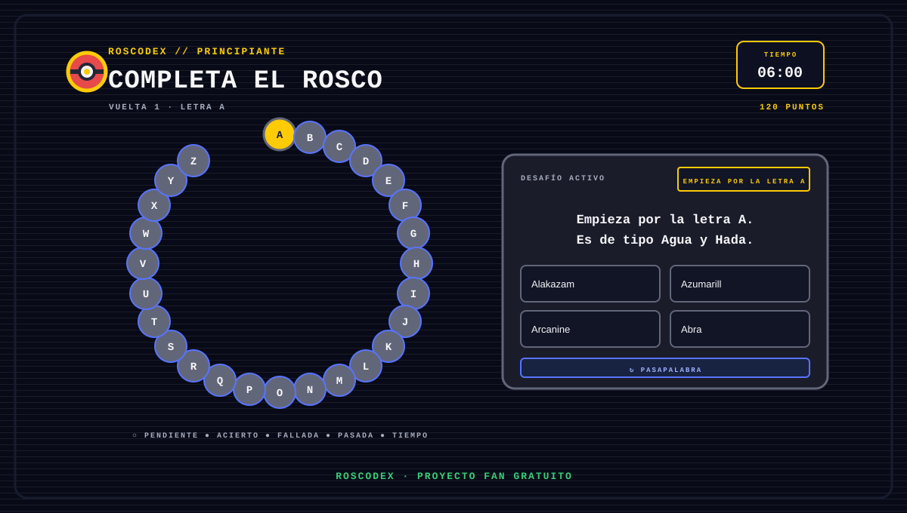
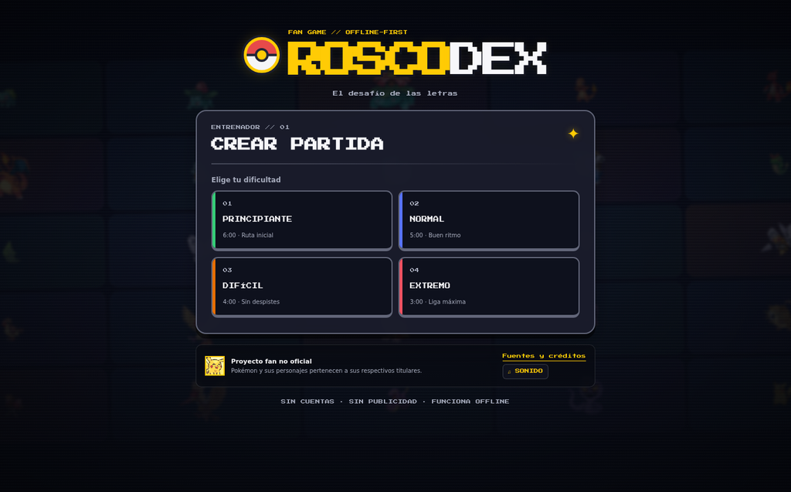
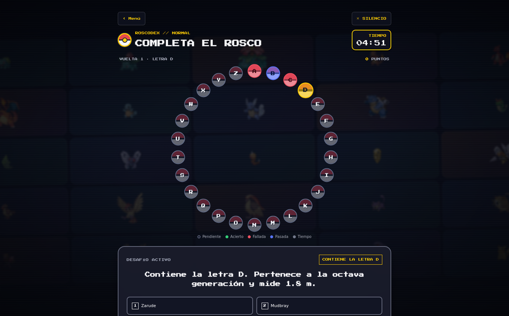
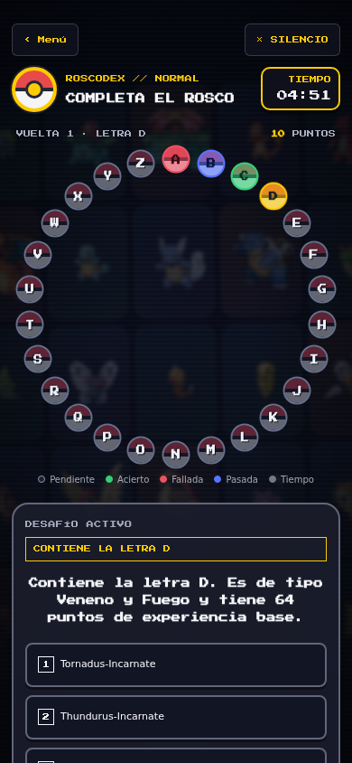

# ⚡ Roscodex ⚡

### *El desafío pixel-art de las letras*

  

  
  
  
  
  

  

> **Aviso:** Proyecto fan no oficial, gratuito y sin ánimo de lucro. Pokémon y sus personajes pertenecen a sus respectivos titulares. No afiliado a Nintendo, Creatures Inc., GAME FREAK inc. ni The Pokémon Company.

---

## 🎮 ¿Qué es?

**Roscodex** es un juego fan, gratuito y no oficial de preguntas tipo rosco (inspirado en el formato clásico de «Pasapalabra») ambientado íntegramente en el universo Pokémon. Cuenta con una cuidada estética pixel-art retro y te desafía a completar las 26 letras del abecedario demostrando tus conocimientos como entrenador.

## 🎯 ¿Para qué sirve?

- **Pasar un buen rato:** partidas rápidas, dinámicas y adictivas de entre 3 y 6 minutos.
- **Poner a prueba tus conocimientos Pokémon:** desde tipos y generaciones hasta estadísticas, habilidades y movimientos.
- **Jugar en cualquier lugar sin conexión:** llévalo en el móvil, tableta u ordenador y juega sin consumir datos ni depender de cobertura.

---

## 📸 Capturas de pantalla

| Portada: elige dificultad | Partida en marcha |
| :---: | :---: |
|  |  |

  <em>En el móvil</em> 
  

---

## 🕹️ Cómo se juega, paso a paso

1. **Abre el juego:** entra en [Roscodex](https://bertmarti.github.io/Roscodex/) desde tu navegador web habitual o ábrelo desde el icono de tu pantalla si lo has instalado como app.
2. **Elige la dificultad:** selecciona uno de los cuatro niveles disponibles (Principiante, Normal, Difícil o Extremo) según el tiempo por partida y la profundidad de las preguntas.
3. **Lee con atención la regla:** cada rosco consta de 26 letras (de la A a la Z). El enunciado te especificará siempre si la respuesta correcta **«Empieza por la letra X»** o **«Contiene la letra X»** (18 letras por rosco empiezan por la letra indicada y 8 la contienen).
4. **Elige tu respuesta:** dispones de **4 opciones posibles**. Si aciertas, sumas **+10 puntos** y la casilla se ilumina en verde; si fallas, se tiñe de rojo.
5. **Usa «Pasapalabra»:** si dudas con una letra, puedes pasarla para no arriesgarte. No penaliza y la casilla quedará en azul para más adelante.
6. **Segunda vuelta:** tras recorrer el abecedario de la A a la Z, volverás una vez más a las letras que hayas dejado pendientes, siempre que el temporizador no haya llegado a cero.
7. **Consulta tu resultado:** al finalizar, la pantalla de resumen te mostrará tu puntuación, tus aciertos, tus fallos y las letras que pasaste. Desde ahí puedes volver a jugar o cambiar de dificultad.

---

## ⌨️ Controles

- **Ratón o pantalla táctil:** toca o haz clic directamente sobre cualquiera de las 4 opciones, el botón de Pasapalabra o las opciones del menú.
- **Atajos de teclado:**
  - Teclas `1`, `2`, `3` y `4`: seleccionar y responder con la opción 1, 2, 3 o 4.
  - Tecla `P`: activar Pasapalabra y aplazar la letra en juego.
  - Tecla `Tab`: navegar de forma accesible entre los botones interactivos.
  - Tecla `Escape`: cerrar cuadros de diálogo o ventanas emergentes.
- **Botón «‹ Menú»:** ubicado en la barra superior para abandonar la partida actual y regresar a la pantalla de bienvenida.
- **Botón de sonido:** activa o desactiva los efectos de sonido 8-bit en cualquier momento (la preferencia se recuerda).

---

## 🏆 Niveles de dificultad

| Dificultad | Tiempo | Contenido de las preguntas |
| :--- | :---: | :--- |
| 🟢 **Principiante** | 6:00 | Tipos y generaciones, sin datos técnicos complejos. |
| 🔵 **Normal** | 5:00 | Datos combinados y algún dato técnico sencillo. |
| 🟠 **Difícil** | 4:00 | Varias condiciones, estadísticas, habilidades o movimientos. |
| 🔴 **Extremo** | 3:00 | Combinaciones avanzadas de datos de combate. |

> **Nota:** En el nivel **Principiante** nunca aparecen preguntas sobre peso, altura, número de Pokédex, experiencia base, estadísticas, movimientos ni habilidades.

---

## 🎨 Colores del rosco

Durante la partida, las casillas del rosco cambian de color para reflejar tu progreso:

- 🟢 **Verde:** acierto (+10 puntos).
- 🔴 **Rojo:** fallo.
- 🔵 **Azul:** letra pasada (pendiente para la segunda vuelta).
- 🟡 **Amarillo:** letra activa (pregunta en curso que debes responder ahora).
- ⚪ **Gris:** sin tiempo (letras que quedaron sin responder al agotarse el reloj).

---

## 📱 Instalar como app (PWA)

Roscodex es una Aplicación Web Progresiva (PWA). Puedes instalarla en tu dispositivo para jugar a pantalla completa y sin conexión a Internet:

- **En Android (Chrome, Edge u otros navegadores compatibles):** abre el menú de opciones (tres puntos) y pulsa en **«Añadir a pantalla de inicio»** o **«Instalar aplicación»**.
- **En iPhone o iPad (Safari):** pulsa el botón **Compartir** (icono de un recuadro con flecha hacia arriba) y selecciona **«Añadir a la pantalla de inicio»**.
- **En ordenador (Chrome o Edge):** haz clic en el icono de instalación situado en la parte derecha de la barra de direcciones.

Una vez instalada, la app funcionará de forma autónoma sin necesidad de conexión a Internet ni cobertura móvil.

---

## ❓ Preguntas frecuentes

<strong>¿Es gratis?</strong>

Sí, es 100 % gratuito. No contiene publicidad, no hay micropagos ni funciones bloqueadas.

<strong>¿Necesito registrarme o crear una cuenta?</strong>

No. Puedes jugar de inmediato sin registrarte ni facilitar ningún dato de contacto.

<strong>¿Se repiten las preguntas?</strong>

El juego cuenta con un banco local de **2.080 preguntas** (520 por cada nivel de dificultad). Tu navegador almacena el historial de preguntas ya formuladas para no repetirlas en partidas sucesivas. Cuando se agotan las preguntas de una dificultad, la aplicación te avisará y te ofrecerá el botón **«Reiniciar rotación»** para volver a activar todo el catálogo.

<strong>¿Funciona sin conexión a Internet?</strong>

Sí. Gracias a la tecnología PWA, tras abrir la web por primera vez, el juego y sus preguntas quedan guardados en tu navegador y puedes jugar en modo avión o sin red.

<strong>¿Guarda o comparte mis datos?</strong>

No. Roscodex no envía ningún dato a servidores externos. Únicamente guarda de manera local en tu navegador tu preferencia de sonido y el registro de preguntas jugadas para gestionar la rotación.

<strong>¿Por qué hay una pregunta con un error o errata?</strong>

Si encuentras cualquier fallo en una pregunta, una errata ortográfica o un dato desactualizado, puedes notificarlo abriendo una incidencia en [GitHub Issues](https://github.com/BertMarti/Roscodex/issues).

<strong>¿Es un juego oficial de Pokémon?</strong>

No. Es un proyecto fan sin ánimo de lucro y sin relación comercial ni oficial con Nintendo, Creatures Inc., GAME FREAK inc. ni The Pokémon Company.

---

## 👏 Créditos y atribuciones

- **[PokéAPI](https://pokeapi.co/):** base de datos de especies, tipos y movimientos.
- **[PokéAPI Sprites](https://github.com/PokeAPI/sprites):** sprites pixelados del fondo.
- **[SpriteCollab](https://github.com/PMDCollab/SpriteCollab):** retrato decorativo de la portada, de la comunidad PMDCollab, bajo licencia [CC BY-NC 4.0](https://creativecommons.org/licenses/by-nc/4.0/).
- **[Press Start 2P](https://fonts.google.com/specimen/Press+Start+2P):** tipografía retro de Cody «CodeMan38» Boisclair bajo licencia [SIL Open Font License](https://openfontlicense.org/).
- **Efectos de sonido:** tonos 8-bit generados en el propio navegador.

*Proyecto fan no oficial, gratuito y sin ánimo de lucro. Pokémon y sus personajes pertenecen a sus respectivos titulares. No afiliado a Nintendo, Creatures Inc., GAME FREAK inc. ni The Pokémon Company.*

---

¿Quieres colaborar o ver cómo está hecho? Lee la [guía de desarrollo](doc/DESARROLLO.md). Licencia [MIT](LICENSE).
